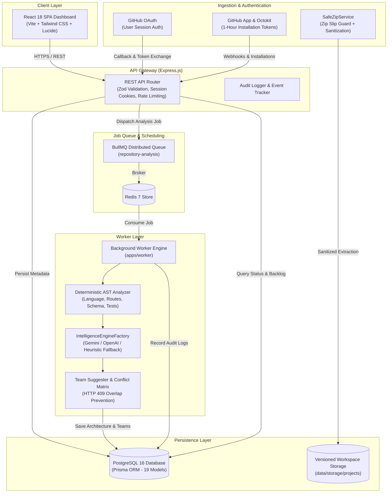

# DevPilot AI — Autonomous GitHub Developer Agent & Hybrid Project Intelligence Platform

<p align="center">
  
  
  
  
  
  
  
</p>

---

## 🌟 Executive Summary

**DevPilot AI** is an enterprise-grade Autonomous Developer Agent and Codebase Intelligence Platform designed to eliminate development friction, automate architecture discovery, and orchestrate verified engineering workflows across legacy and modern repositories.

DevPilot AI bridges existing codebases with autonomous engineering via a **Hybrid Ingestion Architecture**:
1. **GitHub App & OAuth Integration**: Connects live organization repositories with granular, installation-based short-lived permissions.
2. **Zero-Trust ZIP Ingestion Engine**: Allows instant project onboarding via source archives with built-in path-traversal (Zip Slip) sanitization, symlink rejection, regex noise filtering, and SHA-256 versioning.

Once ingested, DevPilot AI executes **deep static AST analysis and multi-model LLM reasoning** to detect languages, frameworks, database schemas, and API routes. It clusters code into architectural domains, generates team assignments, detects and prevents cross-team module conflicts, and constructs an actionable backlog of high-impact engineering tasks.

---

## 🏗️ System Architecture

DevPilot AI is built as a high-performance, modular TypeScript monorepo utilizing an event-driven background job pipeline.



---

## 🚀 Key Features by Phase

### Phase 1: Production Foundation & Security
- **Dual-Layer GitHub Authentication**:
  - **GitHub OAuth App**: Secure user authentication, profile synchronization, and HTTP-only signed session cookies.
  - **GitHub App**: Installation-based repository authorization using short-lived (1-hour) Octokit installation tokens.
- **Enterprise Persistence Layer**: PostgreSQL 16 managed via Prisma ORM with CUID primary keys, relational indexes, and complete audit trails (`AuditLog`, `Session`, `User`, `Organization`).
- **Modern Developer Dashboard**: React 18, Vite, TypeScript, Tailwind CSS, and Lucide React featuring real-time workspace metrics and chronological activity feeds.

### Phase 2A & 2B: Asynchronous Repository Intelligence
- **BullMQ + Redis Worker Pipeline**: Sandboxed background worker execution preventing API blocking during resource-intensive repository analysis.
- **Static AST & Repository Analyzer**:
  - Deterministic language breakdown and file structure mapping.
  - Automated detection of frameworks (React, Express, Next.js, Vue, Fastify, NestJS, etc.).
  - Database schema extraction (Prisma models, SQL DDL tables).
  - API route discovery (`express.Router()`, app-level endpoints, HTTP methods).
  - Test framework identification (Vitest, Jest, Mocha, Cypress, Playwright).
- **Multi-Model LLM Intelligence Engine**:
  - Factory pattern supporting **Google Gemini** (`gemini-1.5-pro`) and **OpenAI** (`gpt-4o`).
  - Resilient **Deterministic Heuristic Provider** as zero-dependency offline fallback ensuring 100% test suite reliability without external API keys.
- **Real-World GitHub App Lifecycle**:
  - Real-time webhook processing (`installation`, `installation_repositories`).
  - Timing-safe HMAC SHA-256 signature verification.
  - Auto-discovery of PEM private keys supporting inline multiline, escaped `\n`, Base64-encoded, and file path formats.

### Phase 3: Hybrid ZIP Ingestion, Team Mapping & Conflict Prevention
- **Zero-Trust ZIP Ingestion Engine (`SafeZipService`)**:
  - Defends against **Zip Slip** directory traversal attacks.
  - Rejects malicious symlinks and suspicious file headers.
  - Enforces atomic extraction, file size limits (50MB default), and file count limits (5,000 files).
  - Regex-based path exclusion filtering out `node_modules/`, `.git/`, `.env*`, `.DS_Store`, build artifacts (`dist/`, `build/`), and binary files.
  - SHA-256 archive hashing with versioned workspace directory storage (`data/storage/projects/{id}/versions/{version}`).
- **Automated Team Ownership Mapping**:
  - Intelligent clustering of codebase modules into functional engineering domains:
    - **Frontend Team**: React, Next.js, Vue, UI components, pages, styles.
    - **Backend API Team**: Express, Fastify, controllers, routes, middleware, services.
    - **Database & Data Team**: Prisma schemas, SQL migrations, database seeders.
    - **DevOps & Infrastructure Team**: Docker, Kubernetes, CI/CD pipelines, configurations.
  - Dynamic team creation with custom hex color badges and developer headcounts.
- **Strict Module Conflict Prevention**:
  - **Module Boundary Isolation**: Ensures private modules cannot be claimed by multiple teams simultaneously.
  - **HTTP 409 Conflict Guard**: Rejects conflicting module claims with a structured error payload detailing the conflict.
  - **Shared Module Support**: Explicitly supports shared utilities and cross-cutting libraries with `isShared: true`.
- **Actionable Task Backlog Generation**:
  - Automatically derives prioritized development tasks from detected architectural patterns.
  - Categorizes tasks by complexity (low, medium, high), priority, estimated files, and recommended acceptance criteria.

---

## 📦 Monorepo Layout

DevPilot AI is organized as an npm workspaces monorepo containing 7 packages and applications:

```
devpilot-ai/
├── apps/
│   ├── api/                     # Express.js REST API gateway, controllers & middleware
│   │   ├── src/controllers/     # Auth, GitHub, Projects, Teams, Modules, Intelligence
│   │   ├── src/services/        # SafeZipService, ProjectService, TeamService, AuditService
│   │   ├── src/middleware/      # Session auth, error handling, rate limiting
│   │   └── src/__tests__/       # 65 automated integration and unit tests
│   ├── web/                     # React 18 SPA developer dashboard
│   │   ├── src/pages/           # Dashboard, Repositories, Hybrid Projects, Intelligence
│   │   ├── src/components/      # Navigation, metrics, team visualizers, task backlog
│   │   └── src/services/        # Typed API client
│   └── worker/                  # BullMQ background queue worker
│       ├── src/processors/      # Repository and project analysis processors
│       ├── src/services/        # Sandboxed runner, cloner, git executor
│       └── src/__tests__/       # 8 worker queue and retry policy tests
├── packages/
│   ├── database/                # PostgreSQL persistence layer with Prisma ORM
│   │   └── prisma/schema.prisma # 19 relational models (User, Project, Team, Module, Run, Task)
│   ├── github/                  # Octokit integration, GitHub App auth & webhook crypto
│   ├── intelligence/            # Static AST analyzer, LLM engine factory & team suggester
│   └── shared/                  # Universal TypeScript types, Zod schemas & constants
├── docs/                        # Architectural specifications and safety documentation
├── docker-compose.yml           # PostgreSQL 16 & Redis 7 infrastructure services
├── .env.example                 # Sanitized environment variable template
├── package.json                 # Monorepo root scripts and workspaces definition
└── tsconfig.base.json           # Shared strict TypeScript configuration
```

---

## 🛠️ Technology Stack

| Domain | Technology | Purpose |
| :--- | :--- | :--- |
| **Frontend** | React 18, Vite, TypeScript | Modern, high-performance developer single-page application |
| **Styling** | Tailwind CSS, Lucide React | Clean, responsive UI with accessible components and icons |
| **Backend API** | Node.js, Express.js, TypeScript | Typed REST API gateway with robust middleware |
| **Validation** | Zod | Runtime schema validation for requests, uploads, and DTOs |
| **Database** | PostgreSQL 16, Prisma ORM | Relational schema with migrations, relational indexing, and audit logging |
| **Job Queue** | Redis 7, BullMQ | Asynchronous, distributed background task processing with backoff |
| **GitHub** | Octokit, GitHub App, OAuth | Granular repository permissions with 1-hour short-lived tokens |
| **AI / LLM** | Gemini 1.5 Pro, GPT-4o, Heuristic | Multi-provider intelligence engine with zero-dependency offline fallback |
| **Infrastructure** | Docker, Docker Compose | Containerized PostgreSQL and Redis for seamless local and production setup |
| **Testing** | Vitest, Supertest | Fast unit and integration test runner with comprehensive coverage |

---

## 🚦 Quickstart & Local Setup

### Prerequisites
- **Node.js**: `>= 20.0.0`
- **npm**: `>= 10.0.0`
- **Docker & Docker Compose**: For PostgreSQL and Redis

### 1. Clone the Repository
```bash
git clone https://github.com/pankaj-codes06/devpilot-ai.git
cd devpilot-ai
```

### 2. Configure Environment Variables
Copy the template and configure your local settings:
```bash
cp .env.example .env
```
*(For local testing and ZIP analysis, default values work out of the box. LLM API keys and GitHub App credentials are only required for live external integrations).*

### 3. Start Infrastructure Containers
Launch PostgreSQL 16 and Redis 7 in detached mode:
```bash
docker compose up -d
```
Verify containers are healthy:
```bash
docker compose ps
```

### 4. Install Dependencies & Build Workspace
```bash
npm install
```

### 5. Initialize the Database
Generate the Prisma client and push the schema to PostgreSQL:
```bash
npm run db:generate
npm run db:push
```

### 6. Start Development Servers
Start the Backend API, Background Worker, and Frontend Dashboard concurrently:
```bash
npm run dev:all
```

Alternatively, run services independently across separate terminals:
```bash
# Terminal 1: Backend API (http://localhost:4000)
npm run dev:api

# Terminal 2: Background Worker (BullMQ processor)
npm run dev --workspace=@devpilot/worker

# Terminal 3: Frontend Dashboard (http://localhost:3000)
npm run dev:web
```

---

## 🧪 Testing & Verification

DevPilot AI maintains a strict 100% test pass policy across all packages and services.

```bash
# Run unit and integration tests (73 / 73 passing)
npm test

# Run full TypeScript typecheck across all 7 packages
npm run typecheck

# Run ESLint across the monorepo
npm run lint

# Build production bundles (Vite + TypeScript compiler)
npm run build
```

---

## 📚 REST API Reference

### 🔐 Authentication & Session
| Method | Endpoint | Description | Auth Required |
| :--- | :--- | :--- | :--- |
| `GET` | `/api/auth/github` | Initiates GitHub OAuth login flow | No |
| `GET` | `/api/auth/github/callback` | Handles OAuth redirect and sets secure session cookie | No |
| `GET` | `/api/auth/me` | Retrieves profile and organizations of logged-in user | Yes |
| `POST` | `/api/auth/logout` | Invalidation and clearance of active session cookie | Yes |

### 🐙 GitHub App Integration
| Method | Endpoint | Description | Auth Required |
| :--- | :--- | :--- | :--- |
| `GET` | `/api/github/install` | Generates GitHub App installation URL | Yes |
| `GET` | `/api/github/callback` | Handles post-installation redirect from GitHub | Yes |
| `GET` | `/api/github/repositories` | Lists accessible repositories from GitHub App installations | Yes |
| `POST` | `/api/github/repositories/sync` | Connects repository and synchronizes metadata into PostgreSQL | Yes |
| `DELETE` | `/api/github/repositories/:id` | Disconnects repository and halts automated jobs | Yes |
| `POST` | `/api/github/webhook` | Receives GitHub App events with HMAC SHA-256 verification | Webhook HMAC |

### 📦 Hybrid Projects (ZIP Workspaces)
| Method | Endpoint | Description | Auth Required |
| :--- | :--- | :--- | :--- |
| `POST` | `/api/projects/upload` | Uploads project ZIP, sanitizes via SafeZipService, extracts version 1 | Yes |
| `GET` | `/api/projects` | Lists all hybrid projects for the active user workspace | Yes |
| `GET` | `/api/projects/:id` | Retrieves single project details, current version, and active team counts | Yes |
| `GET` | `/api/projects/:id/versions/:v/download` | Downloads versioned project ZIP archive | Yes |

### 🧠 Project Intelligence & Analysis
| Method | Endpoint | Description | Auth Required |
| :--- | :--- | :--- | :--- |
| `POST` | `/api/projects/:id/analyze` | Triggers deterministic AST + AI analysis on extracted workspace | Yes |
| `GET` | `/api/projects/:id/intelligence` | Retrieves latest architecture report, frameworks, and schema stats | Yes |
| `GET` | `/api/projects/:id/tasks` | Returns generated development backlog categorized by priority | Yes |

### 👥 Teams & Module Mapping
| Method | Endpoint | Description | Auth Required |
| :--- | :--- | :--- | :--- |
| `GET` | `/api/projects/:id/teams` | Lists all teams and assigned modules for the project | Yes |
| `POST` | `/api/projects/:id/teams` | Creates a new team with custom name and color badge | Yes |
| `GET` | `/api/projects/:id/modules` | Lists all detected modules with their ownership status | Yes |
| `POST` | `/api/projects/:id/teams/suggest` | Generates AI-suggested team assignments based on detected architecture | Yes |
| `POST` | `/api/projects/:id/teams/:teamId/modules` | Assigns module to a team with **HTTP 409 conflict detection** | Yes |
| `DELETE` | `/api/projects/:id/teams/:teamId/modules/:moduleId` | Removes module ownership from a team | Yes |

### 💓 System Health
| Method | Endpoint | Description | Auth Required |
| :--- | :--- | :--- | :--- |
| `GET` | `/health` | Reports API server status, PostgreSQL database connectivity, and uptime | No |

---

## 🛡️ Security & Blast Radius Guardrails

DevPilot AI implements defense-in-depth security principles across all layers:

1. **Zero-Trust ZIP Ingestion (`SafeZipService`)**:
   - Resolves canonical extraction targets to prevent directory traversal (`../../etc/passwd`).
   - Disallows hard links, symbolic links, and device nodes.
   - Restricts maximum extracted size to prevent zip bombs.
2. **Ephemeral GitHub Credentials**:
   - Private keys are stored in secure environment variables or files and normalized in-memory; they are **never stored in the database**.
   - API interactions use GitHub App installation access tokens that expire after **1 hour**.
3. **Timing-Safe Crypto Validation**:
   - GitHub webhook payloads are validated using constant-time `crypto.timingSafeEqual` to eliminate timing attacks.
4. **Mandatory Human-in-the-Loop (Current Phase Policy)**:
   - In accordance with Phase 1–3 requirements, **autonomous source code modification, automatic git commits, and direct branch pushes are disabled by default**.
   - The platform acts as a high-fidelity intelligence and planning engine; code generation will be sandboxed in Phase 4.
5. **Multi-Tenant Isolation**:
   - All queries, repository mappings, and project workspaces enforce strict user and organization foreign key boundaries.

---

## 🗺️ Project Roadmap

- [x] **Phase 1: Foundation & Dual GitHub Integration**
  - PostgreSQL schema, Prisma ORM, Redis, Express REST API, React SPA dashboard.
  - GitHub OAuth sign-in and GitHub App installation token lifecycle.
- [x] **Phase 2A & 2B: Background Intelligence & Real-World Webhooks**
  - BullMQ + Redis job worker pipeline.
  - Deterministic AST static code analyzer and multi-provider LLM factory.
  - GitHub App webhook receiver with timing-safe HMAC validation.
- [x] **Phase 3: Hybrid ZIP Architecture & Automated Team Mapping**
  - Zero-trust ZIP archive upload and sanitized versioned workspaces.
  - Automated team recommendations clustering modules by architecture.
  - Strict cross-team module conflict prevention (HTTP 409).
  - Development task backlog generation.
- [ ] **Phase 4: Sandboxed Autonomous Code Generation & Test Verification**
  - Isolated Docker container runners for autonomous task execution.
  - Automated test execution and linting verification before committing.
- [ ] **Phase 5: Automated Pull Request Generation & Review Loop**
  - Automated branch creation, commit signing, and PR opening with full context.
  - Interactive engineer review loop and autonomous PR adjustment.

---

## 📄 License & Attribution

Distributed under the **MIT License**. See `LICENSE` for more information.

Developed by **[Pankaj Kumar](https://github.com/pankaj-codes06)**.
