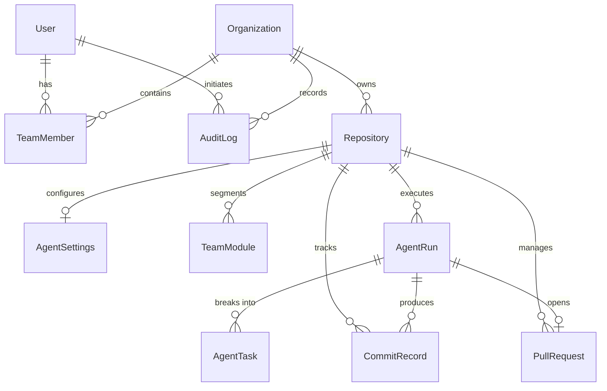

# DevPilot AI — System Architecture (Phase 1)

## 1. Executive Summary

DevPilot AI is an Autonomous GitHub Developer Agent platform designed to connect to existing GitHub team repositories, analyze codebases, identify development tasks, and orchestrate verified Pull Requests.

Phase 1 establishes the production-grade foundation, database models, GitHub App authorization infrastructure, and dashboard interfaces.

---

## 2. Monorepo Architecture

DevPilot AI is organized as a modular TypeScript monorepo with workspace isolation:

```
devpilot-ai/
  apps/
    web/         # React + Vite + Tailwind CSS Developer Dashboard
    api/         # Express.js REST API with Zod validation & auth middleware
    worker/      # Scaffolding for autonomous agent, planner, coder, reviewer, scheduler
  packages/
    database/    # Prisma ORM client and PostgreSQL schema
    shared/      # Cross-cutting types, constants, and Zod schemas
    github/      # Octokit wrapper, GitHub App auth, OAuth client, webhook verifier
  docs/          # Technical and operational documentation
  docker/        # Docker Compose infrastructure (PostgreSQL, Redis)
```

### Module Boundaries & Responsibilities

| Package / App | Purpose | Dependencies |
| :--- | :--- | :--- |
| `@devpilot/shared` | Shared TypeScript types, Zod schemas, constants, API response interfaces | `zod` |
| `@devpilot/database`| Prisma ORM client, CUID models, migration runner, serialization utils | `@prisma/client`, `prisma` |
| `@devpilot/github`  | Decoupled GitHub App token generation, OAuth login, webhook crypto verification | `@octokit/rest`, `@octokit/auth-app` |
| `@devpilot/api`     | Express REST API, session cookies, route controllers, audit logging | Express, CORS, Helmet, CookieParser |
| `@devpilot/web`     | React 18 SPA, Vite, Tailwind CSS dark theme, React Router | React, Tailwind, Lucide React |
| `@devpilot/worker`  | Agent pipeline scaffolding (planner, coder, reviewer, executor) | Future Phase 2 dependencies |

---

## 3. Data Model Architecture (PostgreSQL & Prisma)

The database schema is designed for multi-tenant organizations, enterprise auditability, and autonomous execution history:



### Core Entities

1. **User**: Represents engineer identities authenticated via GitHub OAuth. Stores GitHub user ID and username.
2. **Organization**: Represents the team or enterprise workspace. Every user belongs to at least one organization.
3. **TeamMember**: Maps users to organizations with role-based access control (`OWNER`, `ADMIN`, `MEMBER`, `VIEWER`).
4. **Repository**: Stores authorized GitHub repository metadata (`githubRepoId`, `installationId`, default branch, clone URL, connection status).
5. **AgentSettings**: Configures per-repository autonomous execution parameters:
   - Scheduling cron (default `0 9 * * 1-5` Mon–Fri)
   - Timezone (default `Asia/Kolkata` / IST)
   - Autonomous branch prefix (default `devpilot/`)
   - Path whitelisting and blacklisting
   - Daily run limits and PR review enforcement
6. **AgentRun & AgentTask**: Tracks autonomous execution history, task decomposition, and run states (`QUEUED`, `RUNNING`, `SUCCESS`, `FAILED`).
7. **CommitRecord & PullRequest**: Records exact SHAs and GitHub PR numbers generated by agent runs.
8. **AuditLog**: Comprehensive security log capturing all administrative actions with timestamp, user ID, and IP address.

---

## 4. GitHub Dual-Layer Authentication Flow

DevPilot AI strictly separates **user identity authentication** from **repository authorization**:

```
[User Browser]
      |
      | 1. GET /api/auth/github (OAuth user login)
      v
[GitHub OAuth]
      | 2. Redirect with code & state
      v
[DevPilot API] ---> Verifies state, sets HTTP-only session cookie
      |
      | 3. GET /api/github/install (GitHub App installation)
      v
[GitHub App Settings] (User selects repositories to grant access)
      | 4. Redirect with installation_id
      v
[DevPilot API] ---> Uses GitHub App Private Key to generate short-lived Installation Tokens
      |
      | 5. Lists authorized repos & connects to PostgreSQL
      v
[DevPilot DB]
```

### Key Security Decisions:
- **No Private Keys in Database**: The GitHub App RSA Private Key is loaded exclusively from environment variables (`GITHUB_APP_PRIVATE_KEY`).
- **Short-Lived Installation Access Tokens**: Installation tokens expire automatically after 1 hour and are managed on-the-fly via Octokit.
- **Fail-Closed Permissions**: Without verified organization membership, repository operations fail with `401 Unauthorized` or `403 Forbidden`.

